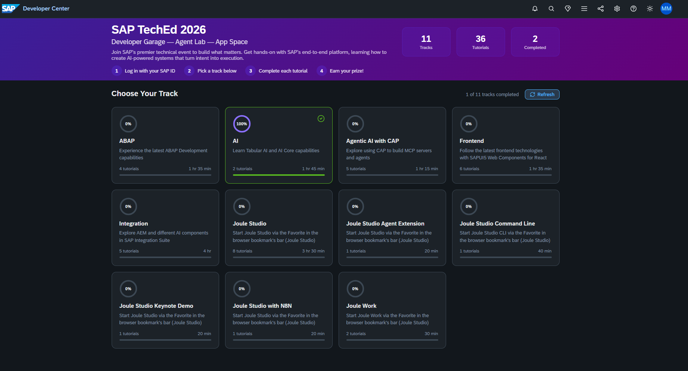

# SAP TechEd 2026

**Developer Garage — Agent Lab — App Space**  
**2026 SAP TechEd Berlin Dev Garage & Agent Lab**

A personal collection of hands-on learning notes, notebooks, and event screenshots from **SAP TechEd 2026 in Berlin**, with a focus on the **AI Track**, **SAP AI Core**, **agentic AI**, and **SAP Generative AI Hub orchestration**.

> **Project status:** Learning materials and a Google Colab adaptation are documented here. Successful execution of live SAP AI Core inference and LLM calls depends on valid service credentials and model availability. No completed tutorial or benchmark result is claimed unless explicitly documented.

## Event overview

The SAP Developer Center **App Space** organizes the Developer Garage activities into **11 tracks and 36 tutorials**, as shown in the event interface. The wider [official mission](https://developers.sap.com/tutorials/mission-2026-sap-teched-berlin-dev-garage-agent-lab) groups its **36 tutorials into 20 mission groups**. These are two different ways of organizing the same event learning resources.

### App Space tracks

| Track | Tutorials shown in App Space | Main focus |
| --- | ---: | --- |
| Joule Studio Keynote Demo | 1 | Joule Studio agent demo |
| Joule Studio | 8 | Building Joule agents |
| Joule Work | 2 | Agent-assisted workflows |
| Joule Studio with N8N | 1 | Workflow automation |
| Joule Studio Agent Extension | 1 | Extending existing agents |
| Joule Studio Command Line | 1 | Command-line agent development |
| ABAP | 4 | ABAP development |
| Integration | 5 | SAP integration capabilities |
| Agentic AI with CAP | 5 | CAP, MCP servers, and agents |
| **AI** | **2** | **Tabular AI and SAP AI Core** |
| Frontend | 6 | UI5 Web Components for React |

*Track counts and descriptions reflect the supplied SAP TechEd App Space screenshot.*

## AI Track — Google Colab lab

The AI Track includes two tutorials:

| Tutorial | Duration | Focus |
| --- | --- | --- |
| [AI #1 — Add Prior Labs TabPFN-3.5 Plus on SAP AI Core to your AI Agent](https://developers.sap.com/tutorials/ai-core-prior-labs-langgraph) | 60 min | Tabular regression/classification, REST inference, LangChain agent |
| AI #2 — Setup SAP AI Core Basic Trial | 45 min | SAP AI Core setup |

I adapted **AI #1** from a local Python / VS Code workflow into a **Google Colab notebook**, allowing experimentation directly in a browser.

### Architecture

```text
Google Colab
  ├── payload_data.py (shipment records and ground truth)
  ├── SAP AI Core OAuth authentication
  ├── TabPFN-3.5 Plus inference
  │     ├── Regression: DELAY_DAYS
  │     └── Classification: LATE (Yes/No)
  ├── LangChain agent + LLM (subject to access)
  │     └── Logistics operations summary
  └── Evaluation
        ├── Mean Absolute Error (MAE)
        └── Classification accuracy
```

The dataset contains **50 labeled context rows** and **10 held-out test rows**: five regression cases and five classification cases. The prediction inputs use `[PREDICT]` placeholders. The notebook evaluates predictions against the provided ground truth.

### Run the notebook

1. Open [Google Colab](https://colab.research.google.com/).
2. Upload [`notebooks/SAP_TechEd_2026_TabPFN_Complete_Colab.ipynb`](notebooks/SAP_TechEd_2026_TabPFN_Complete_Colab.ipynb).
3. Install dependencies using the first code cell.
4. Load `payload_data.py` from [`data/payload_data.py`](data/payload_data.py) or use the notebook's download/upload option.
5. Supply valid SAP AI Core credentials **privately in Colab** and run the authentication check.
6. Run TabPFN regression and classification; inspect MAE and accuracy.
7. Run the optional LangChain/LLM section when the relevant deployment is available.

**Note:** Temporary Developer Garage keys rotate and expire. Do not publish service keys, ZIP archives, passwords, access tokens, `.env` files, or credential-bearing notebook outputs.

## Learning notes — SAP Gen AI Hub orchestration

The accompanying orchestration learning material introduces how **SAP Generative AI Hub orchestration** coordinates models, data, and processing steps. The lesson lists these capabilities:

- Prompt templating and grounding
- Translation
- Content filtering and data masking
- Orchestration workflows
- Configuration and execution
- Harmonized API access

In a basic orchestration workflow, multiple modules can be composed into a pipeline: **request → grounding → prompt templating → data masking → content filtering → LLM access → response**. This section summarizes the lesson shown in the accompanying screenshot; it is not a claim that all these modules were implemented in the TabPFN notebook.

[Introduction to Orchestration — learning journey](https://trials.cfapps.eu10-004.hana.ondemand.com/learning-journey/genai-lpad-gnd/prd-orch-intro)

## Photo gallery

### Developer Garage — App Space track selection




### SAP Gen AI Hub — Introduction to Orchestration

[Introduction to Orchestration lesson and workflow


Additional photos can be added under `gallery/event-photos/` and linked from this section. Avoid uploading attendee photos without appropriate permission or screenshots that expose credentials or personal information.

## Suggested repository structure

```text
SAP-TechEd-2026-Developer-Garage/
├── README.md
├── .gitignore
├── notebooks/
│   └── SAP_TechEd_2026_TabPFN_Complete_Colab.ipynb
├── data/
│   └── payload_data.py
└── gallery/
    ├── app-space-tracks.png
    ├── orchestration-introduction.png
    └── event-photos/
        └── .gitkeep
```

## Key takeaways

- Navigating the SAP TechEd Developer Garage's tracks and tutorials.
- Using a tabular foundation model for shipment-delay regression and late-delivery classification.
- Connecting Python applications to SAP AI Core through authenticated REST calls.
- Integrating predictive tools with LangChain agents and optional LLM reporting.
- Understanding how orchestration modules support grounded, filtered, and governed generative-AI workflows.
- Making hands-on SAP AI experiments reproducible in Google Colab.

## Official starting points

1. [SAP Developer Center — App Space](https://developers.sap.com/app-space/?eventid=10000002&theme=joule)
2. [2026 SAP TechEd Berlin Dev Garage & Agent Lab — mission](https://developers.sap.com/tutorials/mission-2026-sap-teched-berlin-dev-garage-agent-lab)
3. [SAP Gen AI Hub — Introduction to Orchestration](https://trials.cfapps.eu10-004.hana.ondemand.com/learning-journey/genai-lpad-gnd/prd-orch-intro)
4. [AI #1 — Prior Labs TabPFN-3.5 Plus on SAP AI Core](https://developers.sap.com/tutorials/ai-core-prior-labs-langgraph)
5. [SAP tutorial source files](https://github.com/sap-tutorials/Tutorials/tree/master/tutorials/ai-core-prior-labs-langgraph)

---

*Personal learning repository. SAP and SAP TechEd are trademarks of their respective owners. The linked official tutorials and materials belong to their respective publishers.*
